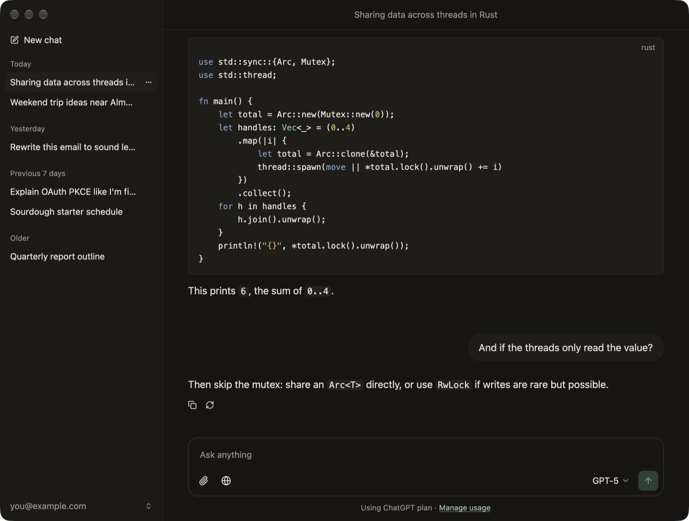

# Patina

A native macOS chat app for your ChatGPT plan, written in Rust.

Patina opens in under half a second, uses about 65 MB of memory at launch and about 100 MB with a long, code-heavy chat open. It does one thing: chat.



## Why

The ChatGPT desktop app became a 1.9 GB Electron bundle that runs Chat, Work and Codex together, and on an 8 GB Mac it shows. Patina is chat only, drawn natively on the GPU with [GPUI](https://www.gpui.rs) and [GPUI Kit](https://gpui-kit.com).

## Features

- **Sign in with ChatGPT.** Uses OpenAI's official plan-usage sign-in for open-source apps. No API key.
- **Streaming Markdown** with syntax-highlighted code, selectable text and copy buttons.
- **Images and PDFs** as attachments, and **web search** when you turn it on.
- **Model picker** with the models your plan offers, plus **custom instructions**.
- **Local history.** Chats are plain JSON files on your Mac. Nothing goes anywhere except your requests to OpenAI.
- **Light and dark**, following macOS.

## What it does not do

OpenAI's plan sharing is a preview and gives apps model access only. That means no chatgpt.com history sync, no memory, no Projects or custom GPTs, no image generation and no voice. Patina keeps its own history instead.

## Install

1. Download the latest `Patina-x.y.z.dmg` from [Releases](https://github.com/syrymuly/chatgpt-rust-client/releases).
2. Drag Patina to Applications.
3. The app is not notarized yet, so macOS blocks the first launch. Open **System Settings > Privacy & Security** and click **Open Anyway**, or run:
   ```sh
   xattr -dr com.apple.quarantine /Applications/Patina.app
   ```
4. After an update, macOS may ask once whether Patina can use its saved sign-in in your Keychain. Choose **Always Allow**.

Requires macOS 12 or later, Apple silicon or Intel, and a ChatGPT Plus or Pro plan.

## Usage limits

Requests count toward your plan's ChatGPT Work and Codex usage, not your regular chat messages. Patina shows **Using ChatGPT plan** under the composer, and you can cap or check usage at [chatgpt.com/settings/usage](https://chatgpt.com/settings/usage).

## Build from source

```sh
cargo run --release
scripts/bundle.sh          # dist/Patina.app and a DMG
```

Needs Rust stable and Xcode command line tools.

## How it works

| Piece | File |
| --- | --- |
| Sign in with ChatGPT (OAuth 2 + PKCE, loopback redirect, RS256 ID token check, Keychain storage) | `src/auth.rs` |
| Responses API streaming over SSE | `src/api.rs` |
| Local chats, attachments and settings | `src/store.rs` |
| UI | `src/ui/` |

## Privacy

- Tokens live in the macOS Keychain. Chats live in `~/Library/Application Support/Patina`.
- Requests go only to `auth.openai.com` and `api.openai.com`, with `store: false`.
- No analytics, no telemetry.

## License

MIT. Patina is an independent project and is not affiliated with or endorsed by OpenAI. ChatGPT is a trademark of OpenAI.
